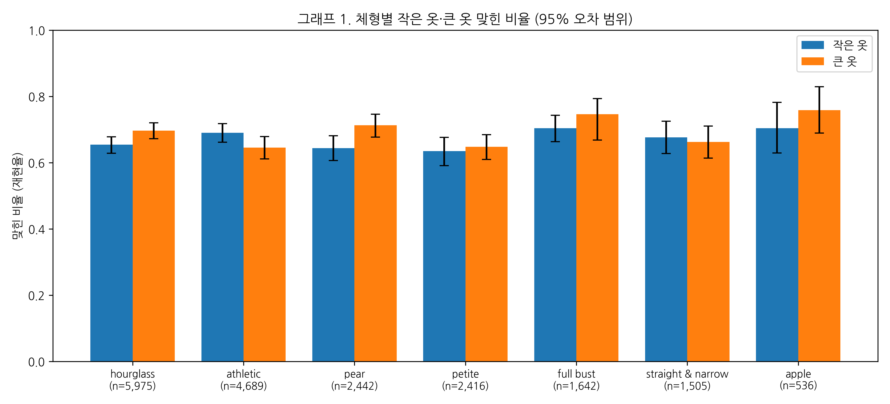
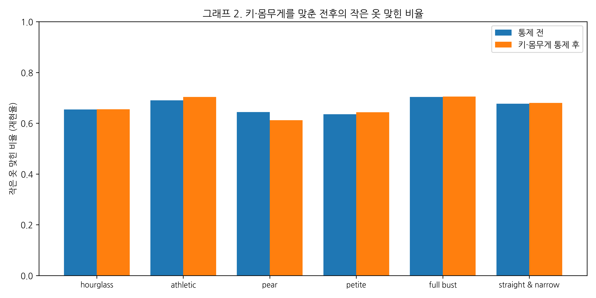
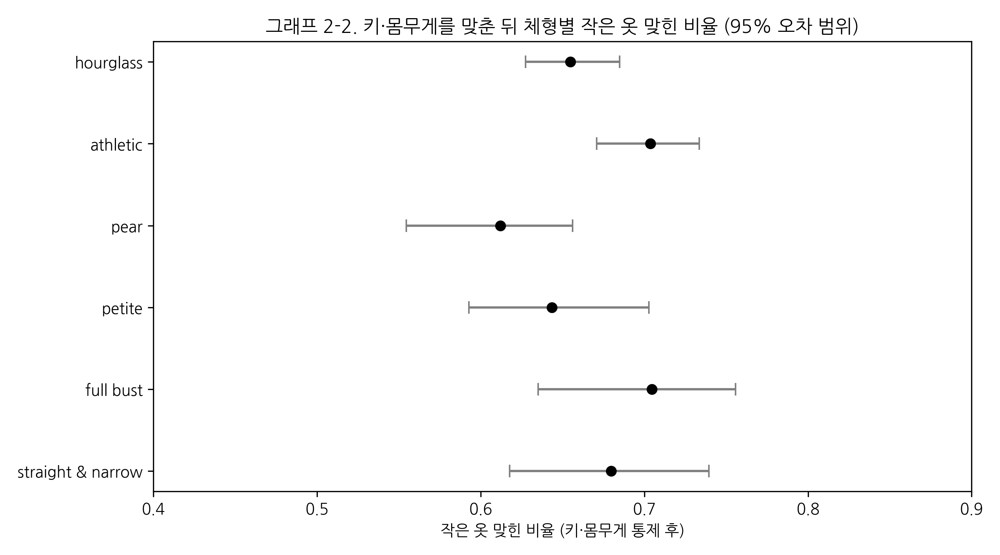
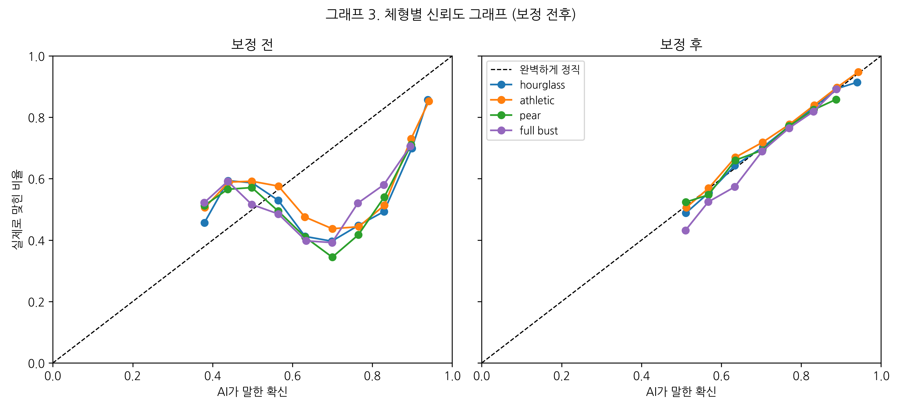
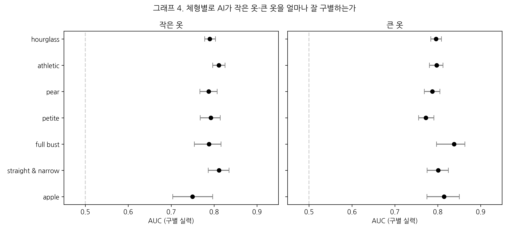
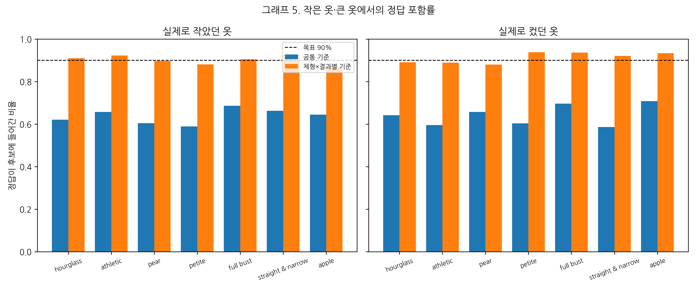
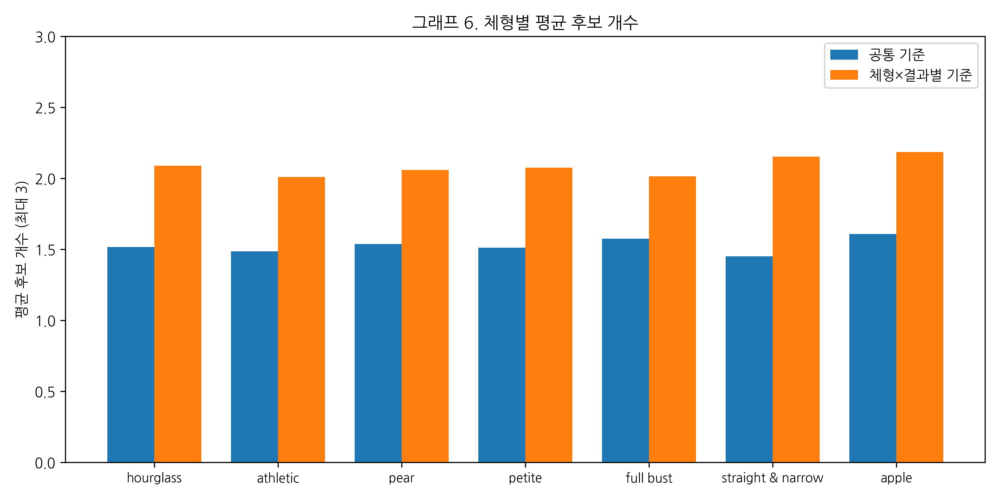
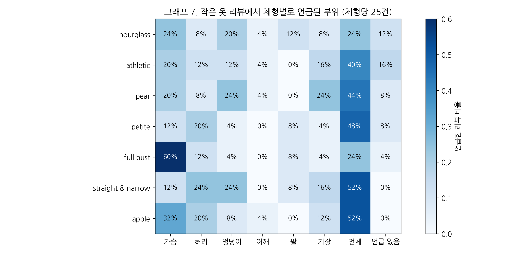

# 체형별 공정성을 고려한 의류 사이즈 추천의 불확실성 보정

본 연구는 온라인 의류 쇼핑의 사이즈 추천 모델이 고객의 체형에 따라 서로 다른 신뢰도를 보이는지 검증하고, 이를 완화하는 보정 방법을 제안한다. 추천 오류가 특정 체형에 집중되면 해당 고객군의 반품 부담이 커지므로, 체형 간 성능 차이는 추천 시스템의 공정성 문제로 볼 수 있다.

Rent the Runway 대여 리뷰 177,524건을 사용해 LightGBM 기반 사이즈 적합도(작음·맞음·큼) 예측 모델을 학습하고, 체형 7종별로 재현율, 확률 보정 정도(ECE), 구별 성능(AUC)을 비교하였다. 키·몸무게 구성 차이에 따른 영향을 배제하기 위해 신체 조건을 통제한 표준화 재현율도 함께 산출하였다. 이어 conformal prediction을 적용해 공통 기준, 체형별 기준, 체형×결과별 기준에서의 정답 포함률과 후보 집합 크기를 비교하였다.

> 빅데이터 시각화 PBL · 덕성여자대학교 데이터사이언스전공 · 조민서, 신윤수

---

## 연구 질문

1. 체형에 따라 사이즈 추천 AI의 성능이 다른가?
2. 그 차이는 키·몸무게가 아니라 정말 체형 때문인가?
3. AI가 말하는 확신은 체형마다 똑같이 정직한가?
4. 체형별로 기준을 다르게 두면 모든 체형이 똑같이 믿을 수 있는 추천을 받는가?

---

## 핵심 결과 요약

| 연구 질문 | 답 | 근거 |
| --- | --- | --- |
| 1. 체형에 따라 성능이 다른가? | **다르다.** 다만 모델이 쓰는 정보에 따라 차이의 크기가 달라진다. | 옷 정보가 없는 v1에서 pear의 작은 옷 재현율은 55.3%로 가장 낮았고 다른 체형과 유의한 차이를 보였다. 옷 정보를 추가한 v2에서는 체형 간 범위가 63.5~70.4%로 좁혀졌다. |
| 2. 그 차이는 체형 때문인가? | **그렇다.** 신체 조건을 통제해도 pear가 가장 불리하다. | 키·몸무게 구성을 동일하게 맞춘 표준화 재현율에서 pear는 v2 기준 61.2%로 가장 낮았고, athletic(70.4%)보다 유의하게 낮았다. 통제 전(64.4%)보다 오히려 낮아져, pear의 불리함이 신체 구성 차이에 가려져 있었음을 보여준다. |
| 3. 확신은 체형마다 정직한가? | **보정 후에는 모든 체형에서 대체로 정직하다.** | 보정 후 전체 ECE는 0.149에서 0.003으로 낮아졌고, 작은 옷의 예상 비율과 실제 비율은 모든 체형에서 1%p 안팎으로 일치했다. 예외적으로 full bust의 큰 옷은 약 4%p 과소 예측되었다. 다만 확률이 정직하다는 것이 고객을 정확히 구별한다는 뜻은 아니므로, 질문 2에서 확인한 pear의 낮은 재현율은 보정으로 바뀌지 않았다. |
| 4. 기준을 달리하면 공평해지는가? | **체형별로, 그리고 작음·맞음·큼마다 후보 포함 기준을 따로 두면 그렇다.** | 공통 기준은 모든 답에 같은 확률 경계를 써서, 원래 확률이 낮게 나오는 '작음'이 후보에서 자주 빠졌다. 그 결과 작은 옷에서 pear의 정답 포함률은 60.4%에 그쳤다. 체형×결과별 기준은 pear의 '작음'처럼 놓치기 쉬운 답의 경계를 낮춰 후보에 넣으므로, 포함률이 89.7%로 올라왔다. 대신 평균 후보 수가 1.5개에서 2.1개로 늘었다. |

전체 평균으로는 공평해 보이는 사이즈 추천 모델도 신체 조건을 통제하면 pear 체형에서 작은 옷을 더 자주 놓친다. 확률 보정만으로는 이 차이가 줄지 않았으며, 체형과 결과를 함께 고려한 conformal 기준을 적용했을 때 모든 체형이 같은 수준의 정답 포함률을 확보할 수 있었다. 또한 옷 정보를 추가해 모델의 구별 성능을 높이자 체형 간 격차와 이를 보정하는 데 드는 후보 수가 함께 줄었다.

---

## 데이터

**RentTheRunway Clothing Fit Dataset**
미국 의류 대여 서비스 Rent the Runway 고객이 옷을 입어본 뒤 남긴 실제 리뷰 데이터. UCSD McAuley Lab에서 공개했다.

- 원출처: https://mcauleylab.ucsd.edu/public_datasets/data/datasets.html (Clothing Fit Data → Renttherunway)
- 인용: Misra, R., Wan, M., & McAuley, J. (2018). Decomposing fit semantics for product size recommendation in metric spaces. *RecSys 2018*.

| 항목 | 내용 |
| --- | --- |
| 규모 | 리뷰 192,544건 · 사용자 105,508명 · 상품 5,850개 |
| 주요 변수 | 키, 몸무게, 가슴 사이즈, 나이, 체형(7종, 고객 선택), 옷 종류, 대여 사이즈, 리뷰 글 |
| 예측 대상 | fit: 작음 / 맞음 / 큼 (맞음 약 74%) |
| 전처리 후 | 177,524건 |

원본 파일(`renttherunway_final_data.json.gz`)은 위 링크에서 내려받아 `데이터/원본/`에 넣으면 된다.

---

## 폴더 구조

```
├─ 데이터/
│   ├─ 원본/                     원본 데이터 (위 링크에서 다운로드)
│   └─ 정리/
│       ├─ 정리데이터.csv          전처리 완료 데이터
│       ├─ 분할명단.csv            사용자별 학습용/보정용/시험용 배정
│       ├─ 학습용_fold배정.csv     옷 정보 계산에 쓴 5-fold 배정 (재현용)
│       ├─ 리뷰샘플.csv            리뷰 분석용 350건
│       └─ 부위추출결과.csv        Gemini 부위 분류 결과
├─ 예측결과/                     보정용·시험용 예측 확률 (v1, v2)
├─ 결과표/v2/                    결과 표 csv, 전체결과_v2.xlsx, 설정값.json, 버전.txt
├─ 그래프/v2/                    논문용 그래프
├─ 코드/
│   ├─ 민서.ipynb                전처리 · 모델 학습 · 체형별 분석 · 보정 · conformal
│   └─ 윤수.ipynb                리뷰 분석 · 웹 시연
└─ 웹시연/                       Streamlit 앱 (app.py, 모델, 설정값)
```

---

## 분석 흐름

### 1. 전처리
- 키·몸무게를 cm·kg으로, 가슴 사이즈를 둘레와 컵(순서형 숫자)으로 변환했다.
- 입력 변수에 결측이 있는 행을 모두 제거하면 체형에 따라 남는 데이터 비율이 71.9 ~ 87.3%로 달라져, 체형·결과·옷 종류·사이즈가 결측인 행만 제거하였다(체형별 99.7~99.9% 유지). 신체 치수의 결측값은 평균 등으로 채우지 않고 그대로 두었으며, 결측값을 자체적으로 처리할 수 있는 LightGBM의 특성을 활용하였다.
- 몸무게 36kg 미만 9건은 결측 처리, 중복 리뷰 25건은 삭제했다.
- 같은 사람의 리뷰가 한쪽에만 들어가도록 **사람 단위로** 학습용 60% · 보정용 20% · 시험용 20%로 나눴다.

### 2. 모델 학습
사이즈 적합도(작음·맞음·큼)를 예측하는 LightGBM 다중 분류 모델을 학습하였다. 전체의 약 74%가 '맞음'이므로 `class_weight='balanced'`로 클래스 가중치를 적용하였다. 학습용 데이터 중 사용자 기준 10%를 검증용으로 분리해 early stopping을 적용했으며, 학습 목표와 조기 종료 기준이 일치하도록 검증 손실도 같은 가중치로 계산하였다.

모델이 사용하는 정보에 따라 체형 간 격차가 달라지는지 보기 위해 두 모델을 비교하였다.

| 모델 | 입력 정보 | 나무 수 |
| --- | --- | --- |
| v1 (기본 모델) | 고객 신체 정보, 체형, 옷 종류, 대여 사이즈 | 66 |
| v2 (옷 정보 추가) | v1 + 옷마다 작게·크게 나오는 정도, 평균 대여 사이즈와의 차이 | 64 |

v2의 옷 정보는 학습용 데이터로만 계산했으며, 정답 누수를 막기 위해 사용자 기준 5-fold out-of-fold 방식으로 산출하였다. v2는 구별 성능(AUC)이 작음 0.69 → 0.80, 큼 0.65 → 0.80으로 향상되어, 이후 분석은 v2를 중심으로 하고 v1은 비교 기준으로 사용하였다.

### 3. 체형별 성능 비교
- 체형별 작음·큼 재현율을 계산하고, 사람 단위 부트스트랩(1,000회)으로 95% 신뢰구간을 구했다.

### 4. 키·몸무게 통제
- 체형별 재현율 차이가 체형이 아닌 키·몸무게 분포의 차이 때문일 가능성을 확인하기 위해, 키(10cm)·몸무게(10kg) 구간별로 체형별 재현율을 산출하였다.
- 이를 전체 고객의 구간 비율로 가중평균하여, **모든 체형이 같은 키·몸무게 구성을 가졌을 때의 재현율**(표준화 재현율)을 구하였다. 실제 작음이 30건 미만인 구간은 제외하였으며, 부트스트랩(1,000회)으로 95% 신뢰구간을 추정하였다.

### 5. 확신도 보정
- 클래스 가중치로 부풀려진 확률을 학습용 정답 비율로 되돌린 뒤, temperature scaling을 적용했다(T는 보정용 데이터로만 추정).
- 체형별 ECE, 작음·큼 확률의 예상 vs 실제 비율, 체형별 AUC를 비교했다.

### 6. Conformal prediction
- 정답이 후보 집합 안에 90% 들어가도록 기준값을 정했다(기준값은 보정용 데이터로만 산출).
- 세 가지 기준을 비교했다.
  - 공통 기준: 모든 체형에 기준값 하나
  - 체형별 기준(Mondrian): 체형마다 기준값
  - 체형×결과별 기준: 체형과 결과(작음·맞음·큼)마다 기준값
- 전체 포함률뿐 아니라 **실제 결과별 포함률**과 평균 후보 수를 함께 확인했다.

### 7. 리뷰 분석
- 작음·큼 리뷰를 체형×결과별 25건씩(총 350건) 뽑아, Gemini(`gemini-3.5-flash-lite`)로 맞지 않은 부위(가슴, 허리, 엉덩이, 어깨, 팔, 기장, 전체, 언급 없음)를 분류했다.
- temperature 0, seed 42로 설정하고, 결과는 `부위추출결과.csv`로 저장해 이후 분석은 이 파일만 사용한다.

---

## 주요 결과

### 체형별 작은 옷 재현율

| 체형 | v1 | v2 | v2 키·몸무게 통제 후 (95% CI) |
| --- | --- | --- | --- |
| hourglass | 58.7% | 65.4% | 65.5% (62.7~68.5) |
| athletic | 64.1% | 69.0% | 70.4% (67.1~73.4) |
| **pear** | **55.3%** | 64.4% | **61.2% (55.5~65.6)** |
| petite | 61.4% | 63.5% | 64.3% (59.3~70.3) |
| full bust | 67.1% | 70.4% | 70.5% (63.5~75.6) |
| straight & narrow | 59.5% | 67.7% | 68.0% (61.8~73.9) |
| apple | 73.0% | 70.4% | 표본 부족 |





### 확신도 보정 (v2)

- 전체 ECE 0.149 → 0.003
- 작은 옷: 모든 체형에서 AI가 예상한 비율과 실제 비율이 1%p 안팎으로 일치
- 큰 옷: full bust만 예상 13.2%, 실제 17.1%로 과소 예측
- 확률 보정은 AI가 말하는 확률을 정직하게 맞출 뿐, 작은 옷을 맞히는 실력(AUC)은 거의 바꾸지 못한다.
- v2에서 이 실력은 체형별로 0.75~0.81로 큰 차이가 없었다.




### Conformal prediction (v2)

| 기준 | pear 작은 옷 포함률 | pear 큰 옷 포함률 | 평균 후보 수 |
| --- | --- | --- | --- |
| 공통 기준 | 60.4% | 65.8% | 1.54 |
| 체형×결과별 기준 | **89.7%** | 88.0% | 2.06 |

- 공통 기준은 전체 평균으로는 약 90%를 지키지만, 이는 맞는 옷(74%)이 평균을 끌어올린 결과다. 작은 옷·큰 옷에서는 모든 체형이 59~71%에 그쳤다.
- 체형별 기준만으로는 이 문제가 풀리지 않았다. 체형×결과별 기준에서 모든 체형이 작은 옷·큰 옷 모두 87~94%를 보장받았다.
- 보장의 대가로 평균 후보 수는 공통 기준 1.5개에서 체형×결과별 기준 2.1개로 늘었다. 다만 같은 체형×결과별 기준에서 v1은 2.5개가 필요했던 반면 v2는 2.1개로, 모델 성능이 높을수록 그 비용이 줄었다.




### 리뷰 분석

| 체형 | 작은 옷 리뷰에서 많이 언급된 부위 |
| --- | --- |
| full bust | 가슴 60% (25건 중 15건) |
| pear | 전체 44% · 엉덩이 24% · 기장 24% |
| straight & narrow | 전체 52% · 허리 24% · 엉덩이 24% |

- full bust는 가슴 때문에 작다는 불만이 뚜렷하다.
- pear는 엉덩이·기장 불만이 조금 많은 경향이 있으나, 체형당 25건이라 리뷰 1~2건 차이 수준이다. 데이터에 엉덩이 치수가 없어 모델이 이를 반영하지 못했을 가능성으로 해석한다.



---

## 웹 시연

Streamlit으로 연구 결과를 직접 체험할 수 있는 화면을 만들었다.

- **사이즈 추천 체험**: 키·몸무게·체형·옷 정보를 입력하면 AI의 작음·맞음·큼 확률과, 공통 기준과 체형×결과별 기준의 추천 후보를 나란히 보여준다. 같은 몸 크기에서 체형만 바꿨을 때의 차이도 확인할 수 있다.
- **연구 결과 대시보드**: 체형을 골라가며 재현율, 정답 포함률, 후보 수, 리뷰 부위 분석을 비교한다.

배포 주소:(https://size-fairness.streamlit.app/)

로컬에서 실행하려면:

```bash
cd 웹시연
pip install -r requirements.txt
streamlit run app.py
```

---

### 재현성

- 모든 무작위 과정은 시드 42로 고정했다.
- 옷 정보 계산에 쓴 `GroupKFold`는 scikit-learn 버전에 따라 배정이 달라질 수 있어, 실제 배정을 `학습용_fold배정.csv`로 저장했다. 사용한 라이브러리 버전은 `결과표/v2/버전.txt`에 있다.
- 결과에 쓴 설정값(T, 기준값 등)은 `결과표/v2/설정값.json`에 있다.

---

## 한계

- 체형은 고객이 스스로 선택한 값이라 정확하지 않을 수 있다.
- 렌탈 고객은 일반 쇼핑 고객과 특성이 다를 수 있다.
- apple은 표본이 적어 통제 분석에서 제외했다.
- 체형×결과별 기준은 공정성을 보장하지만 평균 후보 수가 약 2개로, 실제 서비스에 쓰기에는 정보량이 적다.
- 리뷰 분석은 체형당 25건이라 근거가 약하고, 사람 검수(70건) 일치율 확인이 진행 중이다.
- 신뢰구간의 겹침 여부로 유의성을 판단했다.

---

## 참고 문헌

- Misra, R., Wan, M., & McAuley, J. (2018). Decomposing fit semantics for product size recommendation in metric spaces. *RecSys 2018*.
- Guo, C., Pleiss, G., Sun, Y., & Weinberger, K. Q. (2017). On calibration of modern neural networks. *ICML 2017*.
- Zaffran, M., Féron, O., Goude, Y., Josse, J., & Dieuleveut, A. (2022). Adaptive conformal predictions for time series. *ICML 2022*.
