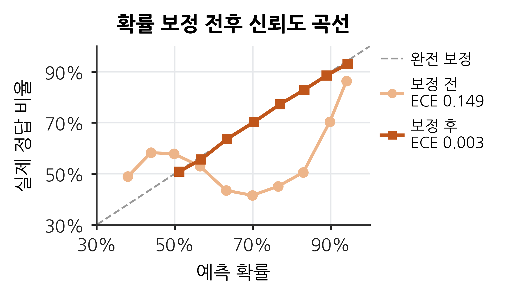
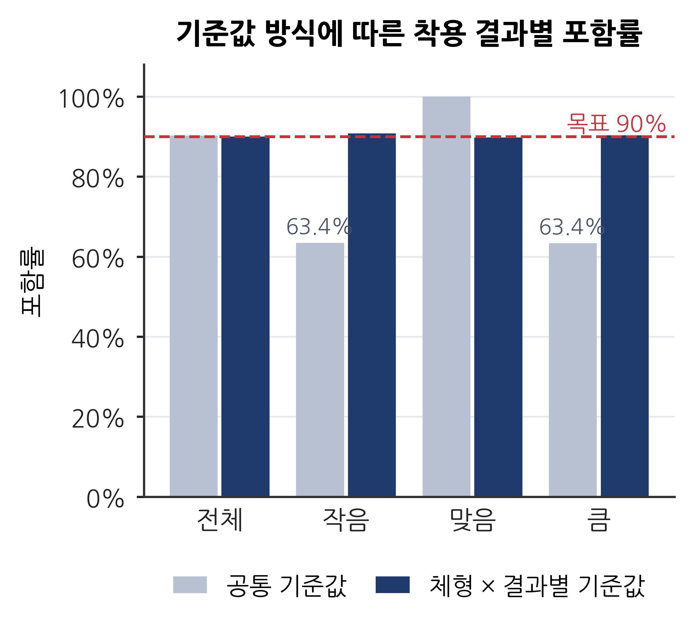

# 체형별 공정성을 고려한 의류 사이즈 추천의 불확실성 보정

온라인 의류 쇼핑의 사이즈 추천은 한 사람에게 하나의 답을 내놓지만, 그 답을 얼마나 믿어도 되는지는 고객의 체형에 따라 다를 수 있다. 추천 오류가 특정 체형에 몰리면 그 고객군의 반품 부담이 커지므로, 체형 간 신뢰도 차이는 추천 시스템의 공정성 문제로 볼 수 있다.

본 연구는 Rent the Runway 대여 리뷰 177,524건으로 사이즈 적합도(작음·맞음·큼)를 예측하는 LightGBM 모델을 학습하고, 예측 확률을 보정한 뒤 conformal prediction으로 후보 사이즈 묶음을 만든다. 이때 기준값을 체형과 착용 결과별로 따로 두면, 전체 평균에 가려져 있던 작은 옷·큰 옷의 낮은 포함률을 모든 체형에서 목표 수준인 90% 근처로 끌어올릴 수 있음을 보인다.

> 빅데이터 시각화 PBL · 덕성여자대학교 데이터사이언스전공 · 조민서, 신윤수

---

## 핵심 결과

| 단계 | 결과 |
| --- | --- |
| 확률 보정 | 전체 ECE 0.149 → 0.003. 보정 후 예측 확률이 실제 정답 비율과 거의 같아졌다. |
| 공통 기준값 | 전체 포함률은 90.2%로 목표를 지키는 것처럼 보이지만, 작은 옷·큰 옷만 보면 체형별로 59~71%에 그쳤다. |
| 체형×결과별 기준값 | 체형별 작은 옷·큰 옷 포함률이 87~94%로 올라왔고, pear 체형의 작은 옷은 60.4% → 89.7%가 되었다. |
| 대가 | 평균 후보 수가 1.51개 → 2.07개로 늘었다. |

---

## 데이터

**RentTheRunway Clothing Fit Dataset**
미국 의류 대여 서비스 Rent the Runway 고객이 옷을 입어본 뒤 남긴 실제 리뷰 데이터. UCSD McAuley Lab에서 공개했다.

- 원출처: https://mcauleylab.ucsd.edu/public_datasets/data/datasets.html (Clothing Fit Data → Renttherunway)
- 인용: Misra, R., Wan, M., & McAuley, J. (2018). Decomposing fit semantics for product size recommendation in metric spaces. *RecSys 2018*.

| 항목 | 내용 |
| --- | --- |
| 규모 | 리뷰 192,544건 · 사용자 105,508명 · 상품 5,850개 |
| 주요 변수 | 키, 몸무게, 가슴 사이즈, 나이, 체형(7종, 고객 선택), 옷 종류, 대여 사이즈, 리뷰 글 |
| 예측 대상 | fit: 작음 / 맞음 / 큼 (맞음 약 74%) |
| 전처리 후 | 177,524건 |

원본 파일(`renttherunway_final_data.json.gz`)은 위 링크에서 내려받아 `데이터/원본/`에 넣으면 된다.

---

## 2. 연구 방법

### 2.1 데이터 및 모델 학습

**전처리**
- 키·몸무게를 cm·kg으로, 가슴 사이즈를 둘레와 컵(순서형 숫자)으로 변환했다.
- 결측이 하나라도 있는 행을 모두 지우면 체형별 잔존 비율이 71.9~87.3%로 달라져, 체형·착용 결과·옷 종류·사이즈가 빈 행만 제거했다(체형별 99.7~99.9% 유지). 신체 치수의 결측은 채우지 않고 LightGBM이 처리하게 두었다.
- 몸무게 36kg 미만 9건은 결측 처리하고, 중복 리뷰 25건은 삭제했다.
- 같은 사람의 리뷰가 한쪽에만 들어가도록 사람 단위로 학습용 60% · 보정용 20% · 시험용 20%로 나눴다(리뷰 기준 105,807 / 35,696 / 36,021건).

**모델 학습**
- LightGBM 다중 분류 모델에 신체 정보(키, 몸무게, 가슴 둘레, 컵, 체형, 나이)와 의류 특성(옷 종류, 사이즈, 상품별 작음·큼 비율, 상품 리뷰 수, 상품 평균 대비 사이즈 차이)을 넣었다.
- 상품별 작음·큼 비율은 정답 정보를 쓰므로, 학습용은 사람 단위 5-fold out-of-fold 방식으로, 보정용·시험용은 학습용 전체로 계산했다.
- 전체의 약 74%가 '맞음'이라, 소수 결과인 작음·큼을 학습하기 위해 클래스 가중치(`class_weight='balanced'`)를 적용했다.
- 학습용 중 사람 기준 10%를 검증용으로 두고 early stopping을 적용했으며, 검증 손실도 같은 가중치로 계산했다. 나무 64개에서 학습이 멈췄다.

### 2.2 확률 보정 및 기준값 설정

**확률 보정**
클래스 가중치는 작음·큼의 예측 확률을 실제 비율보다 부풀린다. 이를 바로잡기 위해 두 단계로 보정했다.
1. **사전확률 복원**: 학습용 데이터의 결과 비율(작음 13.4% · 맞음 73.9% · 큼 12.8%)을 모델 원점수에 다시 반영했다.
2. **온도 스케일링**: 보정용 데이터에서 온도 T = 1.017을 찾아 적용했다.

**기준값 설정**
보정된 확률에 conformal prediction을 적용해, 실제 착용 결과가 후보 사이즈 묶음 안에 90% 들어가도록 기준값을 정했다. 기준값은 보정용 데이터로만 계산했다.
- **공통 기준값**: 모든 리뷰에 기준값 하나(0.836)
- **체형×결과별 기준값**: 체형 7종 × 착용 결과 3종, 21개 집단마다 기준값을 따로 계산(맞음 약 0.38~0.40, 작음·큼 약 0.92~0.95)

### 2.3 평가 방법
- **ECE**: 예측 확률을 15개 구간으로 나눠, 구간별 예측 확률과 실제 정답 비율의 차이를 평균했다. 0에 가까울수록 잘 보정된 것이다.
- **포함률**: 실제 착용 결과가 후보 묶음 안에 들어간 비율. 전체뿐 아니라 착용 결과별, 체형×결과별로 나눠 계산했다.
- **평균 후보 수**: 한 리뷰에 제시되는 후보 사이즈 수(1~3개)의 평균.

모든 평가는 시험용 데이터로 했다.

---

## 3. 연구 결과

### 3.1 확률 보정 결과

| 단계 | 전체 ECE | 체형별 ECE |
| --- | --- | --- |
| 보정 전 | 0.149 | 0.136~0.163 |
| 사전확률 복원 | 0.006 | 0.005~0.030 |
| 사전확률 복원 + 온도 스케일링 | 0.003 | 0.004~0.033 |

보정 전에는 클래스 가중치 때문에 예측 확률이 실제 정답 비율과 크게 어긋났다(ECE 0.149). 사전확률을 복원하자 ECE가 0.006으로 줄었고, 온도 스케일링까지 적용하면 0.003이 되었다. 보정 후에는 예측 확률이 실제 정답 비율과 거의 같아졌으며, 이 확률을 다음 단계의 기준값 설정에 사용했다.



### 3.2 체형×결과별 기준값 적용 결과

| 착용 결과 | 공통 기준값 | 체형×결과별 기준값 |
| --- | --- | --- |
| 전체 | 90.2% | 90.0% |
| 작음 | 63.4% | 90.8% |
| 맞음 | 100.0% | 89.8% |
| 큼 | 63.4% | 90.4% |

공통 기준값에서도 전체 포함률은 90.2%로 목표를 지키는 것처럼 보인다. 그러나 이는 전체의 74%인 맞는 옷이 거의 100% 포함되어 평균을 끌어올린 결과이고, 그 안에 숨은 작은 옷·큰 옷의 포함률은 체형별로 59~71%에 그쳤다.

체형×결과별 기준값을 적용하자 모든 체형에서 작은 옷·큰 옷 포함률이 87~94%로 올라왔다. 특히 pear 체형의 작은 옷은 60.4%에서 89.7%가 되었다. 대신 평균 후보 수는 1.51개에서 2.07개로 늘어, 신뢰 수준을 맞추는 대가로 추천이 덜 구체적이 되었다.



---

## 보조 분석

본문 흐름을 뒷받침하기 위해 진행한 세부 분석이다. 코드는 `1 (1).ipynb`(전체 분석)와 `2.ipynb`(리뷰 분석)에 있다.

### 의류 특성 추가 효과 (v1 vs v2)

옷 정보가 없는 기본 모델(v1)과 의류 특성을 추가한 최종 모델(v2)을 비교했다.

| 모델 | 입력 정보 | 나무 수 | 작음 AUC | 큼 AUC |
| --- | --- | --- | --- | --- |
| v1 | 신체 정보, 체형, 옷 종류, 대여 사이즈 | 66 | 0.69 | 0.65 |
| v2 | v1 + 상품별 작음·큼 비율, 상품 리뷰 수, 평균 대비 사이즈 차이 | 64 | 0.80 | 0.80 |

의류 특성을 넣자 작은 옷·큰 옷을 구별하는 성능이 크게 올라, 본문은 v2를 기준으로 했다. 체형×결과별 기준값의 평균 후보 수도 v1은 약 2.5개였지만 v2는 2.07개로, 모델 성능이 높을수록 공정성을 맞추는 비용이 줄었다.

### 체형별 작은 옷 재현율과 키·몸무게 통제

최고 확률 하나만 답으로 썼을 때 실제로 작았던 옷을 맞힌 비율이다. 키(10cm)·몸무게(10kg) 구간별 재현율을 전체 고객의 구간 비율로 가중평균해, 모든 체형이 같은 키·몸무게 구성을 가졌을 때의 재현율도 구했다. 신뢰구간은 사람 단위 부트스트랩(1,000회)으로 추정했다.

| 체형 | v1 | v2 | v2 키·몸무게 통제 후 (95% CI) |
| --- | --- | --- | --- |
| hourglass | 58.7% | 65.4% | 65.5% (62.7~68.5) |
| athletic | 64.1% | 69.0% | 70.4% (67.1~73.4) |
| **pear** | **55.3%** | 64.4% | **61.2% (55.5~65.6)** |
| petite | 61.4% | 63.5% | 64.3% (59.3~70.3) |
| full bust | 67.1% | 70.4% | 70.5% (63.5~75.6) |
| straight & narrow | 59.5% | 67.7% | 68.0% (61.8~73.9) |
| apple | 73.0% | 70.4% | 표본 부족 |

키·몸무게를 통제하면 pear의 재현율이 가장 낮았고, athletic과는 신뢰구간이 겹치지 않았다. 3.2에서 pear의 작은 옷 포함률이 가장 크게 오른 것과 같은 방향의 결과다.


### 보정 후 체형별 확률 확인

- 작은 옷: 모든 체형에서 보정된 작음 확률의 평균과 실제 작음 비율이 1%p 안팎으로 일치했다.
- 큰 옷: full bust만 예측 13.2%, 실제 17.1%로 과소 예측되었다.
- 확률 보정은 확률의 크기를 바로잡을 뿐 고객을 구별하는 성능(AUC)은 바꾸지 않는다. v2의 체형별 작음 AUC는 0.75~0.81이었다.


### 체형별 기준값만 둔 경우 (v1)

체형마다 기준값을 하나씩만 두는 방식(Mondrian)도 v1에서 비교했다. 체형별 기준값(0.865~0.878)이 공통 기준값(0.871)과 거의 같아, 체형만 나눠서는 작은 옷·큰 옷의 낮은 포함률이 해소되지 않았다. 그래서 본문에서는 착용 결과까지 나눈 체형×결과별 기준값을 사용했다.


### 리뷰 분석

작음·큼 리뷰를 체형×결과별 25건씩(총 350건) 뽑아, Gemini(`gemini-3.5-flash-lite`, temperature 0, seed 42)로 맞지 않은 부위(가슴, 허리, 엉덩이, 어깨, 팔, 기장, 전체, 언급 없음)를 분류했다. 결과는 `부위추출결과.csv`로 저장해 이후 집계는 이 파일만 사용했다.

| 체형 | 작은 옷 리뷰에서 많이 언급된 부위 |
| --- | --- |
| full bust | 가슴 60% (25건 중 15건) |
| pear | 전체 44% · 엉덩이 24% · 기장 24% |
| straight & narrow | 전체 52% · 허리 24% · 엉덩이 24% |

full bust는 가슴 때문에 작다는 불만이 뚜렷했다. pear는 엉덩이·기장 불만이 조금 많았지만 체형당 25건이라 리뷰 1~2건 차이 수준이다. 데이터에 엉덩이 치수가 없어 모델이 이를 반영하지 못했을 가능성으로 해석한다.


---

## 웹 시연

Streamlit으로 연구 결과를 직접 체험할 수 있는 화면을 만들었다.

- **사이즈 추천 체험**: 키·몸무게·체형·옷 정보를 입력하면 보정된 작음·맞음·큼 확률과, 공통 기준값과 체형×결과별 기준값의 추천 후보를 나란히 보여준다. 같은 몸 크기에서 체형만 바꿨을 때의 차이도 확인할 수 있다.
- **연구 결과 대시보드**: 체형을 골라가며 재현율, 포함률, 후보 수, 리뷰 부위 분석을 비교한다.

배포 주소: https://size-fairness.streamlit.app/

로컬에서 실행하려면:

```bash
cd 웹시연/웹시연
pip install -r requirements.txt
streamlit run app.py
```

---

## 폴더 구조

```
├─ 데이터/
│   ├─ 원본/                         원본 데이터 (저장소에 없음, 위 링크에서 다운로드)
│   └─ 정리/
│       ├─ 정리데이터.csv.gz          전처리 완료 데이터 (gzip 압축, pandas로 바로 읽기 가능)
│       ├─ 분할명단.csv                사용자별 학습용/보정용/시험용 배정
│       ├─ 학습용_fold배정.csv         의류 특성 계산에 쓴 5-fold 배정 (재현용)
│       ├─ 리뷰샘플.csv                리뷰 분석용 350건
│       └─ 부위추출결과.csv            Gemini 부위 분류 결과
├─ 예측결과/예측결과/                 보정용·시험용 예측 확률 (v1, v2)과 보정 확률 (v2)
├─ 결과표-20261105T143730Z-1-001/결과표/v2/
│                                    결과 표 csv, 전체결과_v2.xlsx, 논문결과_v2 (1).xlsx,
│                                    설정값.json, 버전.txt
├─ 그래프/그래프/                     v1 그래프
│   └─ v2/                           본문·보조 분석 그래프
├─ 코드/코드/
│   ├─ 정리본.ipynb                   본문 코드: 전처리 · 모델 학습 · 확률 보정 · 기준값 설정 · 3장 표와 그림
│   ├─ 1 (1).ipynb                   전체 분석 (보조 분석 포함): v1/v2 모델 · 체형별 분석 · 보정 · conformal
│   └─ 2.ipynb                       리뷰 분석 · 웹 시연 파일 생성
└─ 웹시연/웹시연/                     Streamlit 앱 (app.py, model_v2.pkl, params.json, item_stats.csv, 대시보드용 csv)
```

---

## 재현성

- 모든 무작위 과정은 시드 42로 고정했다.
- 의류 특성 계산에 쓴 `GroupKFold`는 scikit-learn 버전에 따라 배정이 달라질 수 있어, 실제 배정을 `학습용_fold배정.csv`로 저장했다. 버전.txt와 다른 버전에서 실행할 때는 이 파일로 배정을 불러와야 같은 결과가 나온다.
- 사용한 라이브러리 버전은 `결과표-20261105T143730Z-1-001/결과표/v2/버전.txt`에, 결과에 쓴 설정값(T, 기준값 등)은 같은 폴더의 `설정값.json`에 있다.

---

## 한계

- 체형은 고객이 스스로 선택한 값이라 정확하지 않을 수 있다.
- 렌탈 고객은 일반 쇼핑 고객과 특성이 다를 수 있다.
- 체형×결과별 기준값은 포함률을 맞추지만 평균 후보 수가 약 2개로, 실제 서비스에 쓰기에는 정보량이 적다.
- apple은 표본이 적어 키·몸무게 통제 분석에서 제외했다.
- 리뷰 분석은 체형당 25건이라 근거가 약하고, 사람 검수(70건) 일치율 확인이 진행 중이다.
- 보조 분석의 유의성은 신뢰구간의 겹침 여부로 판단했다.

---

## 참고 문헌

- Misra, R., Wan, M., & McAuley, J. (2018). Decomposing fit semantics for product size recommendation in metric spaces. *RecSys 2018*.
- Guo, C., Pleiss, G., Sun, Y., & Weinberger, K. Q. (2017). On calibration of modern neural networks. *ICML 2017*.
- Zaffran, M., Féron, O., Goude, Y., Josse, J., & Dieuleveut, A. (2022). Adaptive conformal predictions for time series. *ICML 2022*.
